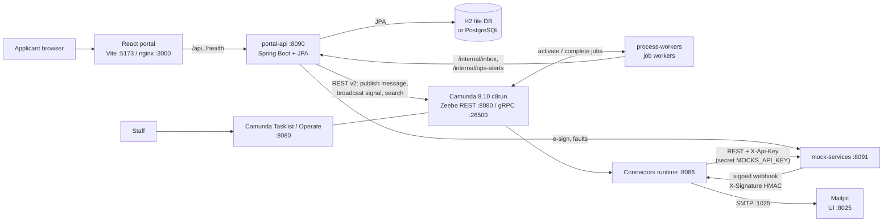
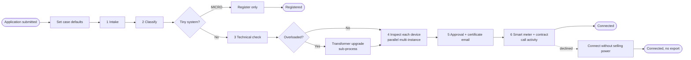

# Smart Grid Solar Microgenerator Connection Approval

Course **21CSE735P Workflow Automation Engineering**, final project, use case **Q25**.
Built on **Camunda 8.10** (c8run 8.10.7, self-managed, local).

The utility in this project, **Metro City Power**, is fictional. All names, addresses, devices, amounts (₹) and
energy figures (kW, kWh) are synthetic demo data.

## Contents

1. [Problem statement](#1-problem-statement)
2. [Solution overview](#2-solution-overview)
3. [Tech stack](#3-tech-stack)
4. [Repository layout](#4-repository-layout)
5. [Architecture](#5-architecture)
6. [Process design](#6-process-design)
7. [DMN decisions](#7-dmn-decisions)
8. [Failure paths](#8-failure-paths)
9. [Connectors and job workers](#9-connectors-and-job-workers)
10. [Portal REST API](#10-portal-rest-api)
11. [FEEL dictionary](#11-feel-dictionary)
12. [Ports](#12-ports)
13. [Setup](#13-setup)
14. [Deploy the models](#14-deploy-the-models)
15. [Run locally](#15-run-locally)
16. [Run with Docker](#16-run-with-docker)
17. [Run the demo](#17-run-the-demo)
18. [Build and test](#18-build-and-test)
19. [Team](#19-team)

---

## 1. Problem statement

A homeowner or a factory wants to connect a rooftop solar system, optionally with batteries, to the Metro City
Power grid. They apply through a React web portal. The utility must check the application, work out whether the
local substation can take the extra power, inspect every device, approve the connection, install a smart meter
and sign a feed-in tariff contract.

Required by the use case:

| Requirement | Where it is in the model |
|---|---|
| Parallel multi-instance safety inspection, one per inverter / battery | `Sub_Inspections` "Inspect each device" (parallel over `devices`) |
| Transformer Capacity Upgrade sub-process | `Sub_Upgrade` "Transformer upgrade" (entered when grid load is `OVERLOAD`) |
| Call activity "Smart Meter Installation & Feed-in Tariff Contract" | `Call_SmartMeter` calls process `smart-meter-contract` |
| REST connector for the weather / solar estimate | `T_Weather` "Estimate solar (weather API)" (HTTP JSON connector) |
| Email connector for the certificate | `A_Email` "Email certificate" (SMTP email connector, delivered to Mailpit) |

## 2. Solution overview

- **BPMN** – a main process `solar-connection-approval` with six stages (embedded sub-processes), four event
  sub-processes for cross-cutting failures, and a child process `smart-meter-contract` started by a call activity.
- **DMN** – six decision files: classification (size, documents, fee, priority), grid load and fallback yield,
  battery check, inspection checklist, final approval and tariff rate.
- **Forms** – 18 Camunda forms for the user tasks, deployed together with the processes.
- **Spring Boot** – `portal-api` (the portal's backend, JPA persistence, talks to Camunda REST API v2),
  `process-workers` (job workers), `mock-services` (stand-ins for external systems) and `decision-tests` (DMN tests).
- **React** – the applicant portal: application wizard with device builder, live process tracker, "Action Required"
  inbox and an ops console (emergency signal, fault injection).

## 3. Tech stack

| Layer | Technology |
|---|---|
| Process engine | Camunda 8.10 self-managed via c8run 8.10.7 (Zeebe, Operate, Tasklist, Connectors runtime) |
| Modelling | BPMN 2.0, DMN 1.3, Camunda Forms, FEEL; linted with bpmnlint + camunda-compat (8.10 rules) |
| Backend | Java 25, Spring Boot 3.5, Spring Data JPA, Camunda Java client 8.10 (`@JobWorker`) |
| Database | H2 file database (default), PostgreSQL (`postgres` profile, used by Docker) |
| Frontend | React 18, Vite 6, Tailwind CSS 3, GSAP, lucide-react |
| Connectors | HTTP JSON (REST) outbound, Email (SMTP) outbound, Webhook inbound with HMAC check |
| Mail | Mailpit (local SMTP sink with web UI) |
| Containers | Docker Compose (postgres, mock-services, portal-api, process-workers, frontend on nginx) |

## 4. Repository layout

```
.
├── README.md
├── docker-compose.yml          # containerised backend + portal (Camunda stays on the host)
├── .env.example                # demo values for docker compose
├── bpmn-models/
│   ├── bpmn/                   # solar-connection-approval.bpmn, smart-meter-contract.bpmn
│   ├── decisions/              # 6 DMN files
│   ├── forms/                  # 18 user task forms
│   ├── deploy/                 # start-all.ps1, deploy.ps1, stop-all.ps1
│   ├── .bpmnlintrc, package.json
│   └── README.md
├── backend-springboot/         # Maven aggregator
│   ├── mock-services/          # :8091 weather, grid, installers, certificates, inspectors, supplier, meter, e-sign
│   ├── process-workers/        # job workers (no web port)
│   ├── portal-api/             # :8090 portal backend (JPA)
│   └── decision-tests/         # DMN decision table tests
└── frontend-react/             # Vite + React portal (:5173 in dev, :3000 in Docker)
```

## 5. Architecture



- The portal never talks to Camunda directly. `portal-api` starts cases and moves them on by **publishing
  messages** (correlation key = `applicationId`) and **broadcasting signals** through the Camunda REST API v2,
  and reads status back with search queries.
- Calls to outside systems (installer registry, weather, grid load, certificates, inspectors, transformer supplier,
  smart meter, e-sign) are **REST connectors** in the BPMN, pointed at `mock-services`.
- Logic that is ours (validation, document check, certificate, export limit, portal inbox, ops alert) runs in
  **job workers** in `process-workers`.
- The mock e-sign service calls the **inbound webhook connector** `mcp-esign-callback` on :8086 with an HMAC
  signature; Camunda checks it with the secret `ESIGN_HMAC_SECRET` before correlating the "Signed" event.

## 6. Process design

### Six stages of `solar-connection-approval`



| # | Stage (element) | What happens |
|---|---|---|
| 1 | Intake (`Sub_Intake`) | Validate the application (worker), detect duplicates, check the installer licence (REST). Missing data → fix request to the portal, reminder after 3 days, close after 7 days, at most 2 rounds, then a manual review. |
| 2 | Classify (`Sub_Classify`) | DMN `ApplicationClassification` gives size class, required documents, fee (₹) and priority. Each required document is checked in a **sequential** multi-instance. Unknown size → manual classification. MICRO systems take the fast path "Register only". |
| 3 | Technical check (`Sub_Technical`) | Solar estimate from the weather REST API (retry, then DMN fallback yield table, then manual estimate), substation load (REST) → DMN `GridLoadStatus`, capacity reservation (REST), battery check DMN. Overload → **Transformer upgrade** sub-process: plan and cost offer, order transformer (compensation: cancel order), second supplier, delivery wait, install, re-check load; export limit as fallback. |
| 4 | Inspect each device (`Sub_Inspections`) | **Parallel** multi-instance over `devices`: certificate check (REST), checklist DMN, book inspector (REST), safety inspection user task, one fix round for minor defects. |
| 5 | Approval (`Sub_Approval`) | Combine results, partial approval if some devices failed, DMN `FinalApproval` (auto approve / reject / manual four-eyes review), generate certificate (worker), **email certificate** (Email connector). |
| 6 | Smart meter + contract (`Call_SmartMeter` → `smart-meter-contract`) | DMN `TariffRate`, install smart meter (user task), send contract for e-sign (REST), wait for the signed **webhook**, decline message or timeout, activate meter + tariff (REST). |

### Roles (lanes) and candidate groups

| Lane | Candidate groups used by user tasks | Typical tasks |
|---|---|---|
| Connection desk | `connection-desk`, `supervisors`, `ops` | Manual intake review, classify manually, get valid certificate, manual post, delay review, ops triage |
| System (automation) | – | Setup script, classification, fast path, call activity, zero-export setup |
| Grid engineer | `grid-engineers` | Manual solar estimate, limit or reject capacity, battery review, upgrade plan, 2nd supplier, install transformer |
| Field inspector | `field-inspectors` | Safety inspection, partner inspector or video check |
| Compliance | `compliance` | Partial approval, first review, second approver (four eyes) |
| (child process) | `meter-technicians` | Install smart meter |

## 7. DMN decisions

| File | Decision id | Hit policy | Purpose |
|---|---|---|---|
| `application-classification.dmn` | `ApplicationClassification` | Literal expression (DRD) | Combines the four decisions below into one `classification` context |
| | `SizeClass` | UNIQUE | Inverter kW → MICRO / SMALL / MEDIUM / LARGE / UNKNOWN |
| | `RequiredDocuments` | COLLECT | List of documents for size, applicant type and battery |
| | `ConnectionFee` | COLLECT SUM | Connection fee in ₹ (sum of matching fee parts) |
| | `CasePriority` | PRIORITY | Case priority from size and applicant type |
| `technical-assessment.dmn` | `FallbackYield` | UNIQUE | Specific yield and peak factor per region when the weather API fails |
| | `GridLoadStatus` | FIRST | Projected load % → OVERLOAD (>100), CRITICAL (≥85), WARNING (≥70), OK |
| `battery-check.dmn` | `BatteryCheck` | ANY | Battery power, capacity limit and certificates → `batteryOk` |
| `inspection-checklist.dmn` | `InspectionChecklist` | RULE ORDER | Ordered checklist items per device type and applicant type |
| `final-approval.dmn` | `FinalApproval` | FIRST | Failed devices, grid status, battery, size, export limit → APPROVE / REJECT / MANUAL_REVIEW + reason |
| `tariff-rate.dmn` | `TariffRate` | UNIQUE | Contract date (financial year) and inverter kW → tariff code and ₹ per kWh |

The decision tables are tested in `backend-springboot/decision-tests` (case files under
`src/test/resources/dmn-cases/`).

## 8. Failure paths

Every "closed" end inside a stage throws error `CASE_CLOSED`; a boundary event on the stage catches it and jumps
(link event "Close case") to **Email closure notice** → "Case closed".

| Situation | Mechanism (element) | Handling |
|---|---|---|
| Duplicate application | Error boundary `DUPLICATE_APPLICATION` on Validate (`I_BDup`) | Closed as duplicate |
| Installer not registered / licence expired | Error `INSTALLER_NOT_FOUND` from connector `errorExpression` (`I_BInst`) | Flag as incomplete, fix request |
| Incomplete data, applicant slow | Receive task + non-interrupting timer (reminder) + interrupting timer (`I_BLapse`) | Reminder, then closed `NO_REPLY`; after 2 rounds manual intake review |
| Weather API down / implausible | Error `SOLAR_API_FAILED` (`T_BWeather`), retry timer, gateway check | Retry, DMN fallback yield, then manual estimate |
| Substation overloaded | DMN `GridLoadStatus` = `OVERLOAD` | Transformer upgrade sub-process |
| Capacity already taken | Error `CAPACITY_TAKEN` on HTTP 409 (`T_BReserve`) | Engineer limits export or rejects |
| Battery unsafe | DMN `BatteryCheck` = false | Engineer review, else closed |
| Cost offer declined / not answered | Event-based gateway: message `cost-offer-declined`, timer `offerExpiry` | Export limit fallback |
| Supplier out of stock | Error `SUPPLIER_OUT_OF_STOCK` (`U_BStock`) | Order from 2nd supplier |
| Transformer delivery too late | Timer boundary `U_BLate` | Compensation: cancel the order (`U_Cancel`), export limit |
| Upgrade taking long | Non-interrupting timer `B_UpSlow` on the sub-process | Tell applicant (portal inbox) |
| Device certificate invalid | Error `CERT_INVALID` (`D_BCert`) | Connection desk gets a valid certificate |
| No inspector free | Error `NO_INSPECTOR` (`D_BBook`) | Partner inspector or video check |
| Inspection overdue | Non-interrupting timer `D_BOver` | Escalation "Inspection overdue" to supervisor |
| Minor / critical defect | Gateway on `inspectionResult.outcome` | Minor: one fix round (message `defect-fixed`); critical: case closed |
| Some devices failed | Script `allPassed` false | Compliance: continue with fewer devices or reject |
| Manual approval, same person twice | Gateway `secondApproverId = firstApproverId` | Reassign the second review (four eyes) |
| Certificate email fails | Error `EMAIL_FAILED` (`A_BEmail`) | Portal inbox + manual post |
| Contract declined | Error `CONTRACT_DECLINED` from child (`B_Declined`) | Connect without selling power (zero export) |
| Contract not signed in time | Error `CONTRACT_EXPIRED` from child (`B_Expired`) | Case closed |
| **Esp_Withdraw** | Interrupting message event sub-process `application-withdrawn` | Compensate completed work, cancel open bookings (REST), "Withdrawn" |
| **Esp_Deadline** | Non-interrupting timer event sub-process (day 18 of 20) | Supervisor reviews the delay |
| **Esp_Error** | Interrupting catch-all error event sub-process | Worker `ops-alert` logs it, ops reviews, case parked |
| **Esp_Emergency** | Non-interrupting signal event sub-process `grid-emergency` | Pause field work, wait for signal `grid-emergency-lifted`, resume |

Technical failures (mock 5xx, timeouts) are retried by Camunda (task `retries`, `retryBackoff`) and then raise an
incident visible in Operate. `mock-services` has a fault switch (`/admin/faults`, also in the portal ops console) to
trigger these paths on demand.

## 9. Connectors and job workers

### Connectors

| Connector | Type | Used by |
|---|---|---|
| HTTP JSON (REST) | `io.camunda:http-json:1` | Installer check, weather estimate, substation load, reserve capacity, order / cancel transformer, certificate check, book inspector, cancel bookings, pause / resume field work, send e-sign envelope, activate meter |
| Email (SMTP) | `io.camunda:email:1` | Email certificate, email closure notice (to Mailpit on 127.0.0.1:1025) |
| Webhook (inbound) | `io.camunda:webhook:1` | "Signed (webhook)" in `smart-meter-contract`, path `/inbound/mcp-esign-callback`, HMAC SHA-256 on the body, header `X-Signature` |

Connector secrets (c8run reads them from environment variables with the `SECRET_` prefix):

| BPMN secret | Env var for c8run | Demo value | Must match in mock-services |
|---|---|---|---|
| `{{secrets.MOCKS_API_KEY}}` | `SECRET_MOCKS_API_KEY` | `demo-mocks-key` | `MOCKS_API_KEY` |
| `{{secrets.ESIGN_HMAC_SECRET}}` | `SECRET_ESIGN_HMAC_SECRET` | `demo-esign-secret` | `ESIGN_HMAC_SECRET` |

These are **demo-only values** for a local, synthetic setup. `start-all.ps1` sets them if they are not already set.

### Job worker types (`process-workers`)

| Type | Element(s) | Does |
|---|---|---|
| `application-validate` | Validate application | Checks required fields, finds duplicates (BPMN error `DUPLICATE_APPLICATION`) |
| `document-check` | Check each required document | Checks one document per sequential instance |
| `register-only` | Register only (fast path) | Registers MICRO systems without a full review |
| `portal-request` | Send fix request, reminder, cost offer, request fix, upgrade delayed | Posts an item to the portal inbox (`requestType` header) |
| `export-limit` | Set export limit (fallback) | Calculates the export limit in kW |
| `zero-export-setup` | Connect without selling power | Sets up a zero-export connection |
| `certificate-generate` | Generate certificate | Builds the compliance certificate |
| `ops-alert` | Log error + alert ops | Posts an ops alert to the portal |

## 10. Portal REST API

`portal-api` on :8090. Unless noted, the Camunda correlation key is the `applicationId`.

| Method + path | Purpose | Camunda / mock call |
|---|---|---|
| `POST /api/applications` | Submit an application (with `submissionId`, optional `demoMode`, `useMockWeather`); returns 202 | message `application-submitted` |
| `GET /api/applications` | List stored cases with Camunda state | process instance search |
| `GET /api/applications/{id}` | Case timeline, variables, incidents, inbox, child instance | searches |
| `GET /api/applications/{id}/inbox` | Requests posted by workers ("Action Required") | – |
| `POST /api/applications/{id}/fix` | Send corrected details | message `fix-submitted` |
| `POST /api/applications/{id}/withdraw` | Withdraw the application | message `application-withdrawn` |
| `POST /api/applications/{id}/offer` | Accept or decline the upgrade cost offer `{accept}` | message `cost-offer-accepted` / `cost-offer-declined` |
| `POST /api/applications/{id}/devices/{serial}/defect-fixed` | Report a device repaired | message `defect-fixed`, key `{id}:{serial}` |
| `POST /api/applications/{id}/contract/sign` | Sign the contract | mock e-sign → inbound webhook |
| `POST /api/applications/{id}/contract/decline` | Decline the contract | message `contract-declined` |
| `POST /api/ops/transformer-delivered/{id}` | Transformer arrived | message `transformer-delivered` |
| `POST /api/ops/emergency` | Declare a grid emergency `{reason}` | signal `grid-emergency` |
| `POST /api/ops/emergency/lift` | End the emergency | signal `grid-emergency-lifted` |
| `GET /api/ops/summary` | Counts of cases, incidents, open tasks, alerts | searches |
| `GET /api/ops/alerts` | Ops alerts | – |
| `GET /api/ops/faults`, `POST /api/ops/faults`, `POST /api/ops/faults/reset` | Read / set / reset mock fault modes | mock `/admin/faults` |
| `GET /api/staff/tasks?state=CREATED&applicationId=` | Staff tasklist: open user tasks with `applicationId` (child smart-meter tasks map to the parent case), assignee, candidate groups | `POST /v2/user-tasks/search` |
| `GET /api/staff/tasks/{key}/form` | Task, its form-js schema and the variables it can see | `GET /v2/user-tasks/{key}`, `GET /v2/user-tasks/{key}/form`, variable searches |
| `POST /api/staff/tasks/{key}/assign` | Claim a task `{assignee}`; 409 if someone else holds it | `POST /v2/user-tasks/{key}/assignment` |
| `POST /api/staff/tasks/{key}/unassign` | Release a claimed task | `DELETE /v2/user-tasks/{key}/assignee` |
| `POST /api/staff/tasks/{key}/complete` | Complete a task with the form values `{variables}` | `POST /v2/user-tasks/{key}/completion` |
| `GET /api/system/status`, `POST /api/system/connect` | Health of portal-api, Camunda, connectors, mocks | probes |
| `POST /internal/inbox` | Worker `portal-request` posts an inbox item | – |
| `POST /internal/ops-alerts` | Worker `ops-alert` posts an alert | – |
| `GET /health` | `{status, camunda}` | `GET /v2/topology` |

## 11. FEEL dictionary

Real expressions taken from the BPMN and DMN files.

### Setup and intake

| Expression | Where | Meaning |
|---|---|---|
| `if demoMode = true then {fixReminder: "PT2M", ...} else {fixReminder: "PT72H", ...}` | `Task_Setup` script (`timers`) | All timer durations in one context; demo mode uses minutes instead of days |
| `hasBattery: system.batteryKwh != null and system.batteryKwh > 0` | `Task_Setup` script | The case has a battery if a positive kWh value was given |
| `if useMockWeather = true then "http://localhost:8091/weather/forecast" else "https://api.open-meteo.com/v1/forecast"` | `Task_Setup` script (`config.weatherUrl`) | Choose the mock or the public weather API |
| `=config.installerUrl + "/" + installer.licenseNo` | `I_Installer` input `url` | Build the registry URL for the installer licence |
| `if error != null and error.code = "404" then bpmnError("INSTALLER_NOT_FOUND", ...) else if error = null and installerCheck != null and list contains(["EXPIRED", "SUSPENDED"], installerCheck.status) then bpmnError(...) else null` | `I_Installer` errorExpression | Turn a 404 or an expired/suspended licence into a BPMN error |
| `=validation != null and validation.complete = true` | Flow `Flow_I_Complete_I_EndOk` | Application is complete |
| `=fixRound < 2` | Flow `Flow_I_Rounds_I_SendFix` | Allow at most two fix requests |
| `=fixRound + 1` | `I_SendFix` output `fixRound` | Count the fix rounds |
| `=timers.fixReminder` / `=timers.fixReply` | Timers on `I_WaitFix` | Reminder after 3 days, give up after 7 days (demo: 2 / 5 min) |
| `=applicationId` | Correlation key of `fix-submitted` (and most messages) | Route the message to this case |

### Classify

| Expression | Where | Meaning |
|---|---|---|
| `system.inverterKw` with entries `]0..1]`, `]1..10]`, `]10..100]`, `> 100` | DMN `SizeClass` input | Size bands by inverter power |
| `{sizeClass: SizeClass, requiredDocuments: if RequiredDocuments = null then [] else RequiredDocuments, ...}` | DMN `ApplicationClassification` | Merge the sub-decisions into one result |
| `=classification.requiredDocuments` (element `document`) | `C_Docs` inputCollection | One sequential check per required document |
| `=context put(classification, "sizeClass", manualSizeClass)` | `C_Manual` output | Replace only the size class with the manual choice |
| `=classification.sizeClass = "MICRO"` | Flow `Flow_Gw_Small_Task_RegisterOnly` | Tiny systems take the fast path |

### Technical check and transformer upgrade

| Expression | Where | Meaning |
|---|---|---|
| `={latitude: string(site.lat), longitude: string(site.lon), hourly: "global_tilted_irradiance", tilt: "20", forecast_days: "1"}` | `T_Weather` queryParameters | Weather API query for the site |
| `={peakIrradiance: if response.body.hourly = null then null else max(response.body.hourly.global_tilted_irradiance)}` | `T_Weather` resultExpression | Keep only the peak irradiance |
| `if peakIrradiance = null then null else {peakKw: peakIrradiance / 1000 * system.pvKw * 0.8, source: "WEATHER_API"}` | `T_Weather` output `solar` | Peak kW = irradiance (kW/m²) × panel kW × 0.8 losses |
| `=solar != null and solar.peakKw != null and solar.peakKw > 0 and solar.peakKw <= system.pvKw * 1.2` | Flow `Flow_T_Plausible_T_YieldMerge` | Estimate is plausible (not above 120 % of panel size) |
| `=solarAttempt < 2` and `=timers.retryWait` | Flow `Flow_T_RetryLeft_T_Backoff`, timer on `T_Backoff` | Retry the API once after a short wait |
| `{peakKw: system.pvKw * fallbackYield.peakFactor, annualKwh: system.pvKw * fallbackYield.specificYield, source: "FALLBACK_TABLE"}` | `T_FbDmn` output `solar` | Estimate from the regional yield table |
| `=(grid.currentLoadKw + system.inverterKw) / grid.capacityKw * 100` | `T_LoadDmn` input `projectedLoadPct` | Substation load in % after connecting this system |
| `> 100`, `>= 85`, `>= 70` | DMN `GridLoadStatus` (FIRST) | OVERLOAD, CRITICAL, WARNING, else OK |
| `if error != null and error.code = "409" then bpmnError("CAPACITY_TAKEN", ...) else null` | `T_Reserve` errorExpression | HTTP 409 means no free capacity |
| `kw: if exportLimited = true and exportLimitKw != null then exportLimitKw else system.inverterKw` | `T_Reserve` body | Reserve the limited kW if an export limit applies |
| `every d in devices[type = "BATTERY"] satisfies d.certificateId != null` | DMN `BatteryCheck` input | All batteries have a certificate |
| `system.batteryKwh <= (if applicant.type = "FACTORY" then 2000 else 30)` | DMN `BatteryCheck` input | Capacity limit depends on applicant type |
| `=gridLoadStatus = "OVERLOAD"` | Flow `Flow_Gw_Overload_Sub_Upgrade` | Enter the transformer upgrade |
| `=context merge(upgrade, {orderId: order.orderId, supplier: order.supplier, etaDays: order.etaDays})` | `U_Order` output | Add the order details to the upgrade context |
| `=(grid.currentLoadKw + system.inverterKw) / newCapacityKw * 100` | `U_Recheck` input | Recheck the load with the new transformer |

### Inspections

| Expression | Where | Meaning |
|---|---|---|
| `=devices` (element `device`, output `inspectionResults`, `=inspectionResult`) | `Sub_Inspections` multi-instance | One parallel inspection per device, results collected in a list |
| `=config.certUrl + "/" + device.certificateId` | `D_Cert` input `url` | Look up this device's certificate |
| `certificateCheck != null and list contains(["EXPIRED", "REVOKED"], certificateCheck.status)` | `D_Cert` errorExpression | Expired or revoked certificate raises `CERT_INVALID` |
| `={serialNumber: device.serialNumber, type: device.type, outcome: inspectionOutcome, insulationMOhm: insulationMOhm, earthOhm: earthOhm, notes: inspectionNotes}` | `D_Inspect` output `inspectionResult` | Store the form result for this device |
| `=inspectionResult != null and inspectionResult.outcome = "MINOR"` / `"CRITICAL"` | Flows after "Result?" | Route minor and critical defects |
| `=applicationId + ":" + device.serialNumber` | Correlation key of `defect-fixed` | Target the right device instance |

### Approval and certificate

| Expression | Where | Meaning |
|---|---|---|
| `=every r in inspectionResults satisfies r != null and r.outcome = "PASS"` | `A_Combine` script (`allPassed`) | All devices passed |
| `count(inspectionResults[outcome != "PASS"])` | DMN `FinalApproval` input | Number of failed devices |
| `=approval.decision = "MANUAL_REVIEW"` | Flow `Flow_A_Decision_A_First` | Send to the four-eyes review |
| `=secondApproverId = firstApproverId` | Flow `Flow_A_SameP_A_SecondMerge` | Same person approved twice, reassign |
| `="Connection approved: " + applicationId` | `A_Email` subject | Certificate email subject |
| `if error != null then bpmnError("EMAIL_FAILED", error.message) else null` | `A_Email` errorExpression | SMTP failure becomes a BPMN error |

### Smart meter and contract (child process)

| Expression | Where | Meaning |
|---|---|---|
| `=today()` | `S_Tariff` input `contractDate` | Tariff is chosen by today's date |
| `[date("2026-04-01")..date("2027-03-31")]` | DMN `TariffRate` input entry | Financial year 2026–27 |
| `={applicationId: applicationId, email: applicant.email, tariffCode: tariff.tariffCode, ratePerKwhRs: tariff.ratePerKwhRs}` | `S_Send` body | E-sign envelope request |
| `=request.body.status = "SIGNED"` | `S_Signed` activationCondition | Only a "SIGNED" webhook moves the process on |
| `=request.body.applicationId` / `=request.body.eventId` | `S_Signed` correlation key / message id | Route the webhook, ignore repeats |
| `=timers.signature` | Timer `S_Timeout` | Contract expires if not signed in time |
| `=esignStatus` | `Call_SmartMeter` output `contractStatus` | Pass the contract status back to the parent |

### Event sub-processes

| Expression | Where | Meaning |
|---|---|---|
| `=if demoMode = true then "PT20M" else "PT432H"` | `Esp_Deadline` timer start | Warn on day 18 of the 20-day target (demo: 20 min) |
| `={reason: if emergencyReason != null then emergencyReason else "Grid emergency"}` | `E_Pause` body | Reason sent when pausing field work |

## 12. Ports

| Port | Service |
|---|---|
| 8080 | Camunda REST API v2, Operate (`/operate`), Tasklist (`/tasklist`) – login `demo` / `demo` |
| 26500 | Zeebe gRPC (job workers) |
| 8086 | Connectors runtime (inbound webhook `/inbound/mcp-esign-callback`) |
| 8090 | portal-api |
| 8091 | mock-services |
| 5173 | React portal (Vite dev server) |
| 3000 | React portal (Docker, nginx) |
| 1025 / 8025 | Mailpit SMTP / web UI |
| 5432 | PostgreSQL (inside Docker network only) |

## 13. Setup

Prerequisites (Windows; PowerShell commands shown):

- Java 25 and Maven 3.9+
- Node.js 20+ and npm
- Camunda 8.10 **c8run** unpacked into a folder `c8run-8.10*` under `%USERPROFILE%\camunda` (or set `CAMUNDA_HOME`)
- Mailpit: `mailpit.exe` in `<CAMUNDA_HOME>\mailpit\` (optional, needed to see emails)
- Docker Desktop (only for [Run with Docker](#16-run-with-docker))

## 14. Deploy the models

```powershell
# 1. start Mailpit + c8run (sets the demo connector secrets if not set)
powershell -ExecutionPolicy Bypass -File bpmn-models\deploy\start-all.ps1

# 2. deploy bpmn/, decisions/ and forms/ in ONE deployment (POST /v2/deployments)
powershell -ExecutionPolicy Bypass -File bpmn-models\deploy\deploy.ps1

# stop everything later
powershell -ExecutionPolicy Bypass -File bpmn-models\deploy\stop-all.ps1
```

`deploy.ps1` takes `-Only bpmn,dmn,forms` and `-BaseUrl http://localhost:8080`. All files go into one deployment
because user tasks and business rule tasks use `bindingType="deployment"`. You can also deploy from Camunda
Modeler, as long as processes, decisions and forms are deployed together.

## 15. Run locally

Start c8run and deploy first (section 14). Then build and start the Java services, each in its own terminal:

```powershell
cd backend-springboot
mvn package -DskipTests

# 1. mock-services (:8091) - values must match the c8run secrets
$env:MOCKS_API_KEY = 'demo-mocks-key'; $env:ESIGN_HMAC_SECRET = 'demo-esign-secret'
java -jar mock-services\target\mock-services-1.0.0-SNAPSHOT.jar

# 2. portal-api (:8090) - run from its own folder so the H2 file goes to portal-api\data\
cd portal-api
java -jar target\portal-api-1.0.0-SNAPSHOT.jar
#    PostgreSQL instead of H2:
#    $env:DB_URL='jdbc:postgresql://localhost:5432/solar'; $env:DB_USER='solar'; $env:DB_PASSWORD='solar'
#    java -jar target\portal-api-1.0.0-SNAPSHOT.jar --spring.profiles.active=postgres

# 3. process-workers (job workers, no web port)
java -jar process-workers\target\process-workers-1.0.0-SNAPSHOT.jar
```

Then the portal:

```powershell
npm --prefix frontend-react install
npm --prefix frontend-react run dev     # http://localhost:5173
```

The Vite dev server proxies `/api` and `/health` to portal-api on :8090. If portal-api is not running, it falls back
to `frontend-react/mock-server.js`, so the UI still works with simulated data.

Useful environment variables (all have local defaults): `CAMUNDA_URL`, `CAMUNDA_USER`, `CAMUNDA_PASSWORD`,
`MOCKS_URL`, `PORTAL_CORS_ORIGINS` (portal-api); `CAMUNDA_REST_URL`, `CAMUNDA_GRPC_URL`, `PORTAL_URL`
(process-workers); `ESIGN_WEBHOOK_URL` (mock-services).

## 16. Run with Docker

Camunda stays on the host (c8run); the containers reach it through `host.docker.internal`.

1. Start c8run on the host and deploy the models (section 14). The connector secrets `MOCKS_API_KEY` /
   `ESIGN_HMAC_SECRET` must have the same values as in `.env` (the defaults are the demo values used by
   `start-all.ps1`).
2. Optional: `cp .env.example .env` to override values (every variable has a demo default, so this is not required).
3. Start the stack:

   ```powershell
   docker compose up --build -d
   ```

4. Open the portal at **http://localhost:3000** (nginx serves the React build and proxies `/api` to portal-api).
   API health: http://localhost:8090/health, mocks: http://localhost:8091/admin/state.
5. Logs: `docker compose logs -f process-workers`. Stop: `docker compose down` (add `-v` to drop the database).

Services: `postgres`, `mock-services` (8091), `portal-api` (8090, `postgres` profile), `process-workers`,
`frontend` (3000). Port 8091 must stay free on the host because the BPMN REST connectors (running in c8run) call
`http://localhost:8091`. Do not run the local Java services at the same time.

## 17. Run the demo

1. Start c8run, deploy, start the services (section 15 or 16) and open the portal
   (http://localhost:5173, or http://localhost:3000 with Docker).
2. In the application wizard pick the preset **Homeowner Solar 6.5 kW** (one inverter, one battery) and submit.
   Demo mode keeps all timers short; "use mock weather" keeps the solar estimate offline.
3. Watch the case in the live process tracker. Intake, classification and the technical check run automatically.
4. Open **Camunda Tasklist** at http://localhost:8080/tasklist (login `demo` / `demo`) and complete the
   **Safety inspection** task for each device (outcome PASS).
5. The approval passes, the certificate is generated and emailed. In Tasklist complete **Install smart meter**.
6. Back in the portal, open **Action Required** and **sign the contract**. The mock e-sign service calls the
   signed webhook, the meter and tariff are activated, and the case shows **COMPLETED**.
7. Open **Mailpit** at http://localhost:8025 to see the "Connection approved" email with the certificate id.

Other presets: **Factory Solar Array 45 kW + Storage** (three devices, factory rules) and
**High Substation Load (Upgrade Trigger)** (transformer upgrade sub-process). Use the ops console to declare a
grid emergency or switch on mock faults to see the failure paths; Camunda Operate (http://localhost:8080/operate)
shows the token flow and incidents.

## 18. Build and test

```powershell
# Java: all modules, unit + DMN tests (drop -o for the first build so Maven can fetch dependencies)
cd backend-springboot
mvn -o test

# BPMN lint (bpmnlint recommended + Camunda 8.10 compatibility rules)
cd bpmn-models
npm install
npx bpmnlint bpmn/*.bpmn

# Frontend
npm --prefix frontend-react install
npm --prefix frontend-react run dev      # or: run build
```

## 19. Team

| Register no. | Name | Section | Area |
|---|---|---|---|
| RA2411003010429 | Vinesh Reddy | G1 | BPMN and DMN models, forms, FEEL; Spring Boot backend (portal-api, process-workers, mock-services, tests); Docker |
| RA2411003010398 | Harish Neralla | G1 | React portal (application wizard, live status tracker, action inbox, ops console) |
| RA2411003010621 | Tarakeshwar B | J1 | React portal (frontend) |
